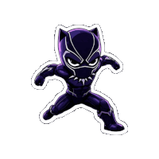
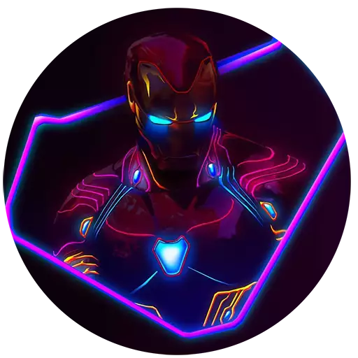
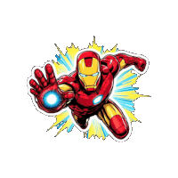

<!-- 🎬 HERO  video intro -->

  

 

  
  &nbsp;&nbsp;&nbsp;&nbsp;&nbsp;&nbsp;&nbsp;&nbsp;&nbsp;&nbsp;
  
  &nbsp;&nbsp;&nbsp;&nbsp;&nbsp;&nbsp;&nbsp;&nbsp;&nbsp;&nbsp;
  

 

<!-- 🍥 MY NINJA WAY -->

  

<!-- 🔦 JUTSU ARSENAL -->

  

<!-- 🪪 NINJA REGISTRATION + MISSION DASHBOARD -->

  

## 🍥 S-Rank Missions

<table>
<tr><th>Mission / Project</th><th>Mission Brief</th><th>Jutsu / Tech</th><th align="center">Threat Rank</th></tr>
<tr><td><a href="https://github.com/Adu602126/woman-saftey"><b>woman-saftey (SafePath)</b></a></td><td>Real-time emergency telemetry, risk scoring & omnichannel SOS beacon system</td><td><code>TypeScript</code> <code>React</code> <code>Firebase</code></td><td align="center"><b>S-RANK</b></td></tr>
<tr><td><a href="https://github.com/Adu602126/J.A.R.V.I.S"><b>J.A.R.V.I.S</b></a></td><td>Automated AI system assistant with voice-driven intelligent tasks</td><td><code>Python</code> <code>AI / ML</code></td><td align="center"><b>A-RANK</b></td></tr>
<tr><td><a href="https://github.com/Adu602126/nexusforge-ai"><b>nexusforge-ai</b></a></td><td>Machine learning model training and intelligent prediction pipeline</td><td><code>Python</code> <code>ML</code></td><td align="center"><b>A-RANK</b></td></tr>
<tr><td><a href="https://github.com/Adu602126/STUDENT_REPORT_CARD_SYSTEM"><b>Student Report Card System</b></a></td><td>Robust academic record management & student evaluation database</td><td><code>C++</code> <code>DBMS</code> <code>DSA</code></td><td align="center"><b>B-RANK</b></td></tr>
<tr><td><a href="https://github.com/Adu602126/The-Riser"><b>The-Riser</b></a></td><td>Interactive personal portal & dynamic responsive web interface</td><td><code>JavaScript</code> <code>HTML</code> <code>CSS</code></td><td align="center"><b>B-RANK</b></td></tr>
<tr><td><a href="https://github.com/Adu602126/Ben-14-site"><b>Ben-14-site</b></a></td><td>Cinematic character animation showcase with responsive interactions</td><td><code>JavaScript</code> <code>HTML</code> <code>CSS</code></td><td align="center">⭐ <b>1</b></td></tr>
</table>

<a href="https://github.com/Adu602126?tab=repositories"><b>→ See all 16 repositories</b></a>

  

### 🏙️ My Stark Tower Contributions

*Every commit fortifies Stark Tower — rebuilt automatically every day.*

  

<!-- 🐍 CONTRIBUTION SNAKE -->

  

<!-- 📊 ACTIVITY GRAPH -->

  

<!-- 💌 JOIN THE SQUAD -->

  

 

**Avengers Assemble — keep coding, keep building.** ⚡ 🍥

